<div align="center">


# Deviload

**Your music, videos and clips in one desktop app.**

Discover and listen with Devil Music. Save with yt-dlp. Create with Devil Cut and Devil Convert.
<br>
Built with Rust and Tauri 2 В· English, Russian and Spanish

[](https://github.com/Pronexsteam/deviload/releases/download/v2.16.0/Deviload-2.16.0-setup.exe)
[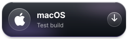](https://github.com/Pronexsteam/deviload/releases/download/v2.16.0/Deviload-2.16.0-macos-test.zip)
[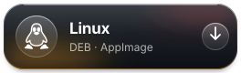](#install-on-linux)
[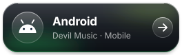](https://github.com/Pronexsteam/DevilMusic/releases/download/v0.0.18/Devil-Music-0.0.18-android.apk)

Desktop downloads: **2.16.0** В· Android: **0.0.18 preview**

<p>
<a href="https://github.com/Pronexsteam/deviload/releases/latest"></a>
<a href="https://github.com/Pronexsteam/deviload/releases"></a>
</p>
<p>
<a href="https://github.com/Pronexsteam/deviload"></a>
<a href="https://github.com/Pronexsteam/deviload/actions/workflows/ci.yml"></a>
</p>

[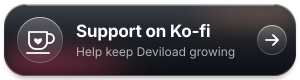](https://ko-fi.com/pronexsteam)

Deviload is free. If it saves you time, a coffee helps me keep building it.

**[Devil Music](#devil-music)** В· **[What can I do with it?](#what-can-i-do-with-it)** В· **[Install](#installation)** В· **[Screenshots](#screenshots)** В· **[Report an issue](https://github.com/Pronexsteam/deviload/issues/new)**

</div>

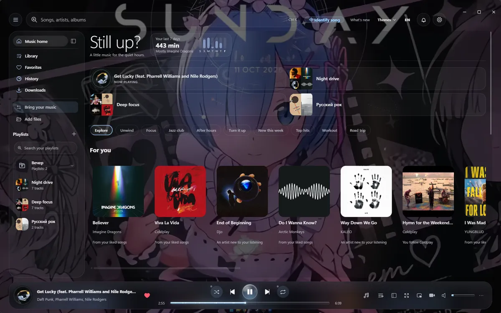

Deviload is a free, open-source desktop app for discovering music, keeping a local media collection and making clips. Listen in **Devil Music**, save video or audio with [yt-dlp](https://github.com/yt-dlp/yt-dlp), and send downloaded files to **Devil Cut** or **Devil Convert**.

Built with Rust and [Tauri 2](https://tauri.app), with English, Russian and Spanish interfaces. Windows is the main target; Linux packages and an unsigned macOS test build are also available. See [installation](#installation) for the differences between platforms.

## Devil Music

Open the YouTube Music catalog and start listening without a Devil Music account or a YouTube Music subscription.

- **Find something to play:** search songs, artists, albums and playlists; save favorites and keep a queue.
- **Bring your collection:** import public Spotify playlists and albums, YouTube playlists, or a snapshot of a YouTube Mix. Signed in, bring your YouTube Music liked songs and playlists, or your Spotify Liked Songs and playlists, private ones included. Review uncertain matches before accepting them.
- **Name that song:** Identify song beside the search listens to the room, to this computer's sound or to an audio or video file, and finds the song here. Songs found are kept to search again or like in one click. Only a fingerprint of the sound is sent for recognition.
- **Keep your likes in step:** turn on daily likes in music settings and new YouTube Music likes come over to Liked songs once a day. The account is only read.
- **Play it on the TV:** cast to a Chromecast or DLNA TV or speaker on your Wi-Fi. The player on the computer keeps the queue and lyrics and steers the device.
- **Make discovery your own:** likes and listening shape local recommendations. Choose familiar music or more discoveries, and hide songs or artists you do not want.
- **Stay with the music:** one Lyrics button shows the words wherever the player is. In the full player the lines move in and out of focus; timed words fill as they are sung when the lyrics source provides word timings. Lyrics stay in time on every version of a song: the recording that plays is measured once against the studio recording the lyrics are timed on. The words can also run over the music video like subtitles, float on your desktop, or become a picture to share with Share a line.
- **Liquid glass player:** the play button is a glass orb that breathes with the bass, the timeline fills like a glass tube, and panels, windows and menus glide. Hover the timeline to see the time and the line sung there; the mouse wheel seeks and sets the volume.
- **Watch the music video:** the camera button opens the song's official video on its own stage, silent and in step with the music, in up to 1080p and full screen.
- **Make room on your desktop:** switch to a small, rounded mini-player with a vinyl cover, playback controls, repeat, shuffle, seeking and volume. Its video mode shows the music video in a window you can resize and pin above other windows. Returning restores the main window.
- **Control it from your phone:** click the remote icon and scan its QR code on the same Wi-Fi. The phone follows your theme; sound stays on the computer. No account or hosted server is needed.
- **Fine-tune playback:** playback speed is one click away in More and on the [ and ] keys, and songs on your computer stored without loss show a Lossless mark.
- **Something new every day:** the home shows new albums and singles from artists you follow, and moods such as Unwind, New this week, Top hits, Workout and Road trip open at once. A playlist downloads for offline listening in one click.
- **Take it elsewhere:** export liked songs and playlists as CSV, M3U or JSON, and show the song playing in OBS with the local control API's overlay page.
- **Set the mood:** Ambient carries the cover colors across the workspace and reacts to the audio. Choose from eight themes, adjust the equalizer, or keep motion reduced. The next track is prepared in advance to reduce waiting.
- **Make it yours:** the Your own theme puts a photo, GIF or silent looping video behind the workspace. Adjust blur, darkening, panel transparency, ambient light and the accent color. Files up to 300 MB are accepted, roughly 2 to 5 minutes of Full HD video; a 10 to 60 second loop looks best.
- **Arrange it your way:** Edit layout, in the Themes menu, lets you drag blocks and player buttons to another place, hide the ones you do not need, swap the side panels or reset everything. A folded library stays as a rail of icons and playlist covers.
- **Look back at your listening:** open your week, month or year in a stats window with your top artists and songs.
- **Only the music, if you like:** choose Only Devil Music on the first start or later in music settings to open straight into the player. Updates and your library stay the same.
- **Keep a copy:** queue an MP3 download from a song card or the player without interrupting playback. Supported completed audio downloads can play offline.
- **Take your preferences with you:** export and restore a local music profile with likes, playlists and taste settings. The backup contains metadata, not music files or account credentials.

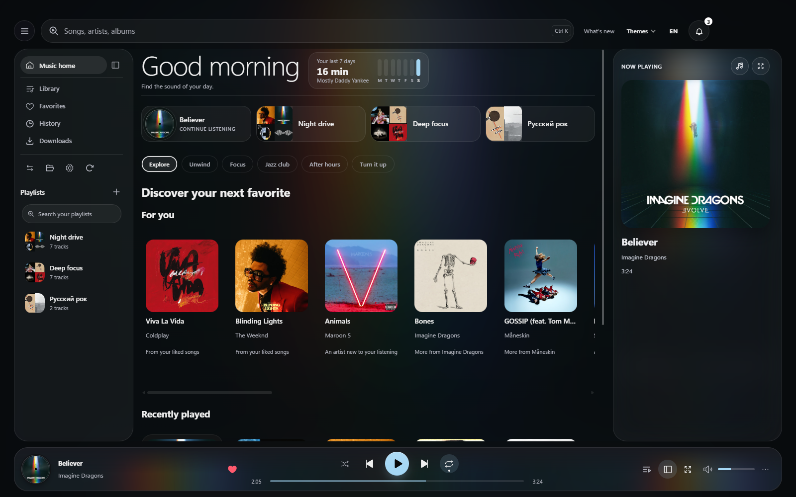

Playback and catalog availability depend on YouTube, your region and your connection. Spotify imports match metadata to playable catalog tracks; they do not download Spotify audio. A Spotify preview may omit tracks, and a YouTube Mix import is a snapshot of up to 100 songs rather than a continuously synced playlist. See [data and privacy](#data-and-privacy) for the services contacted.

## Devil Music on Android

Devil Music is built into Deviload on desktop. A **native Android preview** brings the player to phones and tablets. Discover music, keep a queue, turn the picture disc and switch to lyrics in a layout that adapts to portrait and landscape.

[**Visit Devil Music в†’**](https://github.com/Pronexsteam/DevilMusic) В· [**Download the Android APK в†’**](https://github.com/Pronexsteam/DevilMusic/releases/download/v0.0.18/Devil-Music-0.0.18-android.apk)

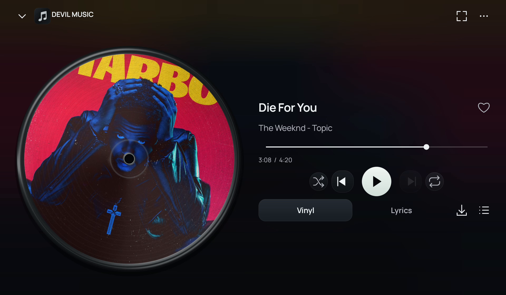

Android 8.0 or newer is required. This is a preview with its own app data and GPL-3.0-or-later license; desktop Deviload stays MIT-licensed. Library transfer uses an explicit file, not automatic account sync. Word-level lyrics depend on available timing data. The Android download is separate from Deviload's desktop updater. Version 0.0.18 and newer check GitHub for updates while the app is open; Android asks you to confirm installation. Install over your existing preview to keep its library and settings.

## What can I do with it?

### Build a music collection

Open **Devil Music**, find an album or use **Bring your music** to import a public playlist. Save favorites, arrange a listening queue and download the songs you want to keep as MP3. Your local preferences help shape the next recommendations.

### Save a video and make a clip

Paste a link in **Downloads**, choose video or audio and check the available source streams. Open the finished file in **Devil Cut** to trim or arrange clips, then export a video, GIF or audio file. **Devil Convert** can also convert a local file or fit an export to a size limit. The source file stays unchanged.

### Keep a channel in your media library

Follow a channel or playlist to check for new uploads every six hours while Deviload runs. For a home media server, choose **For Jellyfin / Plex** as the download subfolder and configure Jellyfin, Emby or Plex in settings. Deviload organizes the files and can ask the server to scan after the download batch finishes.

### Record a live stream

Add a live link to record from that moment, then stop when you have what you need or set a duration limit. A scheduled recording can repeat daily while Deviload is running. The result stays in your local library; its container depends on the selected format and whether final packaging succeeds.

## Latest update

**Deviload 2.16.0 brings sound moods, lyric videos, a map of your taste and lights that follow the music.** Play a song Slowed + reverb, as Nightcore or in 8D, turn a few sung lines into a vertical video with the song's sound, see the artists you listen to as a star chart, and light your keyboard and strips in the cover's colour on every beat through OpenRGB. Deviload closes to the tray, the queue saves as a playlist, lyrics can be searched, and listening rooms show who is listening and end cleanly.

Read the [2.16.0 release notes](.github/release-notes/v2.16.0.md).

## Installation

Windows opens the x64 installer; macOS opens the unsigned test-build archive. Linux opens the package choices below. Android downloads the separate [Devil Music](https://github.com/Pronexsteam/DevilMusic) APK. The Release badge opens the [latest desktop release](https://github.com/Pronexsteam/deviload/releases/latest). Choose the asset for your system:

| System | Release asset | Instructions |
|---|---|---|
| Windows x64 | `Deviload-<version>-setup.exe` or `Deviload-<version>-windows-x64-portable.zip` | [Windows installation](#install-on-windows) |
| macOS В· test build | `Deviload-<version>-macos-test.zip` | [macOS installation](#install-on-macos-test-build) В· unsigned and not notarized |
| Linux x86_64 | `Deviload-<version>-amd64.deb` or `Deviload-<version>-x86_64.AppImage` | [Linux installation](#install-on-linux) |

**Documentation:** [Requirements](#requirements) В· [Build from source](#build-from-source-windows) В· [Releases](#releases) В· [Data and privacy](#data-and-privacy) В· [Translations](#translations)

## Features

- **Download your way:** video, audio, playlists and live streams, with saved profiles and a persistent queue.
- **Keep a library:** search, favorites, collections, tags and a built-in player.
- **Listen with Devil Music:** discover music, bring playlists, build a queue, get recommendations that adapt to your taste and download songs as MP3.
- **Create with Devil Cut:** trim, arrange clips and export video, audio or GIFs.
- **Stay connected:** watched channels, artist releases, media servers, local file transfer and a separate music remote.
- **Make it yours:** three interface languages, proxy settings, settings backups and reduced motion.

<details>
<summary><strong>Explore all features</strong></summary>

- **Download workspace** with the link field, format controls and queue together, readable progress and six coordinated themes. Motion respects the system's reduced-motion preference.
- **Batch actions** to pause, resume, retry or cancel selected tasks and send completed files to a phone. Clearing completed tasks keeps the library and its file count intact.
- **Saved profiles and settings backup**: reuse download options and destination rules, export profiles, and preview settings imports before restoring them. Backups exclude cookies and account credentials.
- **Downloads** from YouTube, YouTube Music and every other site yt-dlp supports. Best, 1080p, 720p or 480p video as MP4 (plays everywhere, H.264 and AAC when the site has them), MKV (the best streams as they are) or WebM; MP3, FLAC or WAV audio. Profiles for music, archive, phone (MP4) and maximum quality.
- **One link field.** Paste one or more links, or drop a link from the browser anywhere on the window. A preview with the title, duration and the real streams of the source appears by itself; an exact stream can be picked.
- **Playlists**: whole list, first N items or exact ranges, a track picker by title, and splitting by chapters. Subtitles, SponsorBlock removal and a per-format download archive.
- **Live streams** record from the moment you add the link: the task shows the time recorded and the size so far, "Stop recording" keeps the captured media, and an optional limit (15 minutes to 24 hours) stops it by itself. With a start time, a length and "Repeat every day" it records the same stream at the same time daily while Deviload runs. A recording cut off when Deviload closes is recovered at the next start where possible; if final packaging fails, the original capture is kept.
- **Watched channels and playlists**: new videos in a followed list download by themselves, in the format picked when the list was added. Lists are checked every 6 hours while Deviload runs, including from the tray.
- **Follow an artist**: give the link of an artist's channel on YouTube or YouTube Music, and every album, EP and single from its Releases tab downloads as MP3 or FLAC into Artist / Album folders, with track numbers, the release year and a square cover. The albums already out can be fetched too; new releases follow by themselves.
- **For Jellyfin, Emby and Plex**: one subfolder choice lays videos out as dated episodes of their channel (Channel / Season year / Channel - date - title) with an `.nfo`, a thumbnail, a `tvshow.nfo` and a poster, and music by artist and album. With the server address and an API key, Deviload asks the server to scan once the downloads finish.
- **Queue** with 1 to 8 parallel downloads, pause, resume, reorder, delayed start, automatic retry of temporary network errors, a per-task log and readable error hints. The queue survives restarts; interrupted tasks resume only when you ask. It can put the computer to sleep or shut it down when the downloads finish, after a minute you can cancel.
- **Self-healing downloads**: known failures are fixed once before a task gives up: your Deviload sign-in when YouTube asks to sign in, the usual quality when an exact stream is gone, a yt-dlp update (when nothing is downloading) when YouTube changes its protection, and a pause after rate limiting.
- **Readable errors** with a fix button: sign in for age-restricted, private or members-only videos, update yt-dlp when YouTube changes its protection.
- **Download archive that follows the disk**: a file deleted from the disk downloads again next time, and when yt-dlp still skips something it downloaded before, the task says how many and "Download again" brings it back.
- **Pre-flight check** before adding: engines present, save folder writable, free disk space, links already downloaded.
- **Library** of finished files with favorites, collections, tags, search, a duplicate finder and a built-in player that remembers the position and shows chapters and subtitles. Sort it by date, size, length or name, group it by channel, and show it as large tiles, small tiles or a list; each file shows its length and size. Removing a file can delete it from the disk too: it goes to the Recycle Bin or Trash, and Undo brings the task back for a few seconds.
- **Devil Cut**, a video editor in its own window, in the spirit of CapCut:
  - media from your downloads on the left, a live preview in the middle, clip settings on the right, and a timeline you can make taller, with the clips' sound, separate sounds and music on their own rows;
  - split at the playhead, select multiple clips to delete or duplicate together, drag to reorder, drag edges to trim, enter precise in/out boundaries, undo and redo, zoom from a two-hour project down to single frames, full screen; long videos stay smooth;
  - detach a clip's sound and move, trim or split it on its own track;
  - transitions between clips (crossfade, through black, slide, wipe, circle) and a sound wave on the tracks;
  - per clip: speed 0.5Г— to 3Г—, volume, smooth start and end, rotation, mirror, brightness, contrast, saturation and a caption;
  - frame formats 16:9, 9:16, 1:1 and 4:5 with fit, fill or a blurred background; export to MP4 at the original size, 4K, 1440p, 1080p, 720p or 480p in H.264 or H.265, GIF or MP3 with progress, into the folder the video came from or one you choose;
  - projects are saved automatically, and source files are never changed.
- **Audio tools** for MP3, FLAC and WAV: tags and loudness normalization, saved as a new copy.
- **Devil Convert** in its own window: drop any video or audio file from the computer, or send one from the library, and get MP4, MP3, a GIF, or a video that fits a size limit (Discord 10 MB, WhatsApp 16 MB, mail 25 MB or your own) through two-pass encoding. The original stays as it is; results go next to it or into the export folder shared with Devil Cut.
- **Phone link** over the local network: one QR code opens a page on the phone that downloads the files you send from Deviload, sends photos and videos back to the computer (each one needs your OK), and adds links to the download queue. The link turns off after 30 minutes without the phone, and the page can be added to the phone's home screen.
- **Search** YouTube and YouTube Music inside the app.
- **Devil Music**: guest playback, albums and playlists, a full-screen Now Playing view, shuffle, repeat, queue editing and similar songs when the queue ends. The next song is prepared in advance to reduce waiting. Availability depends on YouTube and your network; restricted or unavailable tracks can still fail.
- **Download from Devil Music** with the MP3 button on a song card, queued song or the player. It adds a task to the download queue without stopping playback, using your save folder and download authentication settings. Your unfinished download form stays intact.
- **Bring your music**: import public Spotify playlists and albums, YouTube playlists, and snapshots of up to 100 songs from YouTube Mix links. Spotify previews can omit tracks; a Mix may differ from your signed-in recommendations and will not update automatically. Matching can be stopped or canceled; uncertain matches remain reviewable.
- **Your music taste stays local**: likes, listening and early skips shape recommendations. Hide songs or artists, choose familiar music or more discoveries, and export/import a compact profile before reinstalling or changing computers. No Devil Music account or paid server is needed.
- **Music controls** in the mini-player, phone remote, Windows taskbar thumbnail and tray menu, plus supported system media controls.
- **Site sessions** for YouTube, Instagram, TikTok and X: supported embedded sign-in windows save a session for that site only. YouTube on Linux uses cookies from your regular browser or a `cookies.txt` file instead of embedded Google sign-in. Firefox cookies or your own `cookies.txt` also work on Windows and macOS (and Chrome, Edge, Brave or Safari on macOS).
- **Updates**: Deviload checks GitHub at start and hourly while the app is visible and updates itself in one click on Windows, macOS and in the AppImage, all from one release (the portable zip and the .deb package point to the releases page); yt-dlp updates itself to the nightly build once a day when nothing is downloading, which can be turned off in the settings.
- **Proxy** for downloads, search, link checks and yt-dlp updates (HTTP, HTTPS, SOCKS4 and SOCKS5).
- **Moving from Deviload 1.x**: the history, settings and the list of downloaded videos of the old portable version move over in one click; cookies are not copied.
- Tray mode and start with Windows, OS notifications, clipboard link suggestions, links from a text file, a copyable yt-dlp command in every task log, keyboard shortcuts (Ctrl/⌘+L links, Ctrl/⌘+K queue search, Ctrl/⌘+Enter download, Escape closes dialogs) and a short guided tour. Only one copy of Deviload runs at a time; starting it again brings the open window forward.

</details>

## Screenshots

The screenshots below show the 2.7.8 interface with sample media, original demo artwork and demo lyrics. They are captured from the app frontend, not design mockups.

### Browse and read lyrics

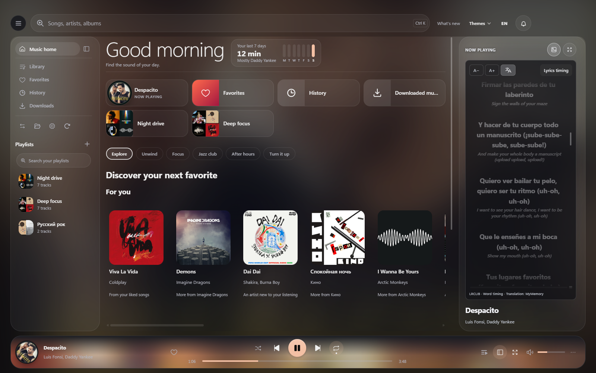

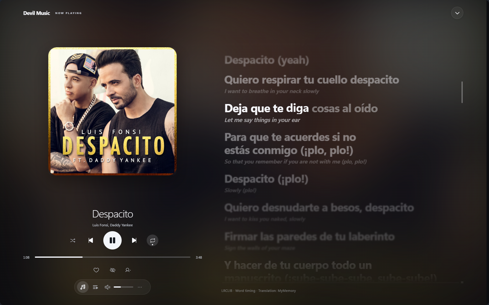

### Keep the controls close

| Compact desktop player | Phone remote |
|---|---|
| 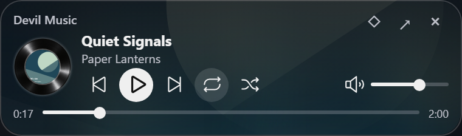 | 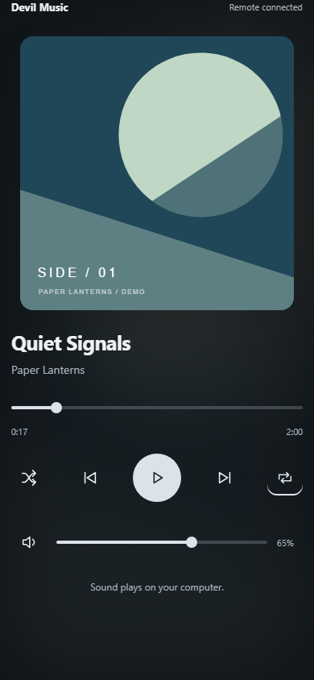 |

The phone controls the desktop player over your local network; it does not stream audio to the phone or create a shared listening room.

### Download and convert

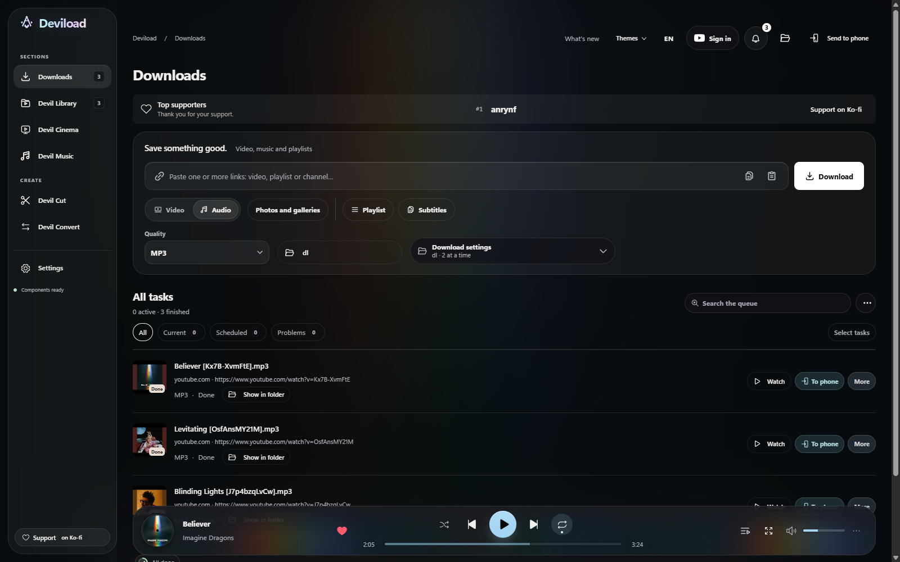

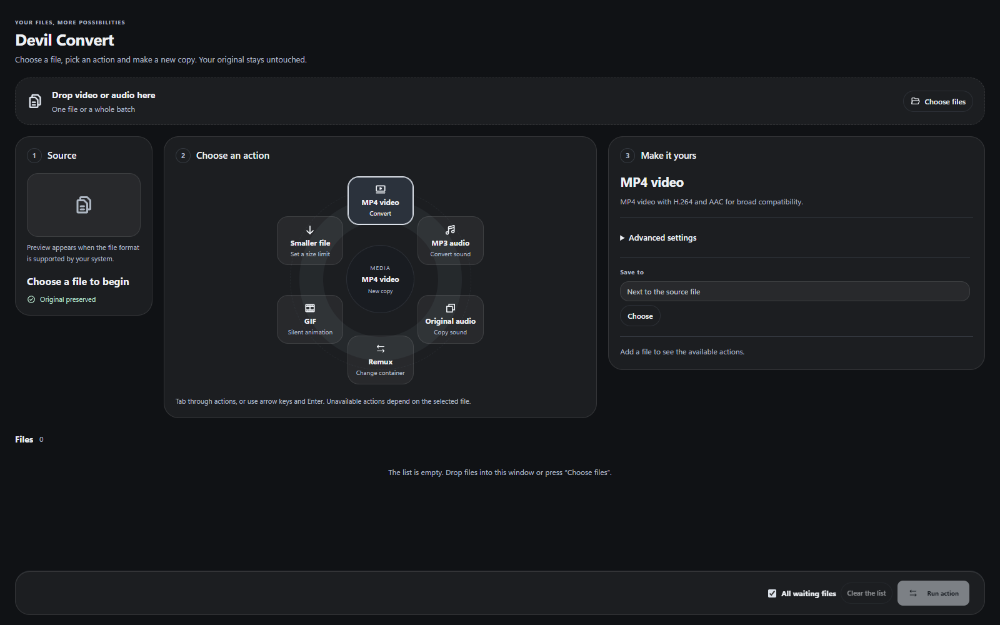

## Install on Windows

Download `Deviload-<version>-setup.exe` from the releases page and run it. It installs for the current user without administrator rights, adds a Start menu shortcut (in the Pronexsteam folder) and brings yt-dlp, FFmpeg and Deno along. Any folder you can write to works; folders inside Program Files need administrator rights, so the installer stops and says so. Later versions install from inside the app. A portable zip is published next to it.

## Install on macOS (test build)

Download `Deviload-<version>-macos-test.zip` from the [latest release](https://github.com/Pronexsteam/deviload/releases/latest), extract it and move `Deviload.app` to Applications. The build is not signed with an Apple Developer ID or notarized. Before the first start, run:

```sh
xattr -cr /Applications/Deviload.app
```

The archive includes yt-dlp, FFmpeg and Deno. The in-app updater signature is separate from Apple code signing.

## Install on Linux

**Download 2.9.0:** [Debian / Ubuntu (.deb)](https://github.com/Pronexsteam/deviload/releases/download/v2.9.0/Deviload-2.9.0-amd64.deb) В· [AppImage (x86_64)](https://github.com/Pronexsteam/deviload/releases/download/v2.9.0/Deviload-2.9.0-x86_64.AppImage)


`sudo apt install ./Deviload-<version>-amd64.deb` on Debian or Ubuntu, or make the AppImage executable (`chmod +x Deviload-<version>-x86_64.AppImage`) and run it. Both bring yt-dlp, FFmpeg and Deno along; the AppImage updates itself from inside the app, the .deb package is updated by installing the new one. The built-in player uses the system's GStreamer, so MKV playback needs its usual plugins (`gstreamer1.0-plugins-good`).

## Requirements

Deviload runs yt-dlp, FFmpeg, FFprobe and Deno as separate processes. It looks for them next to the executable, in a `bin` folder next to it, and in `PATH` (plus `/opt/homebrew/bin` and `/usr/local/bin` on macOS). Windows also needs the Microsoft Edge WebView2 Runtime, which Windows 10 and 11 normally include.

## Build from source (Windows)

You need Node.js 22 or newer, Rust with the MSVC toolchain and Visual Studio Build Tools with the C++ workload and a Windows SDK.

```powershell
npm ci
powershell -ExecutionPolicy Bypass -File scripts\fetch-tools.ps1   # yt-dlp, FFmpeg, FFprobe, Deno into .\bin
npm run tauri dev                                                  # run in development mode
powershell -ExecutionPolicy Bypass -File scripts\package.ps1      # installer, portable zip and latest.json in .\dist
```

`scripts\package.ps1` builds the release, copies the installer to `dist\Deviload-<version>-setup.exe`, writes the update feed `dist\latest.json` and assembles a portable `dist\Deviload\` folder (`Deviload.exe`, the engines in `bin\`, the licence texts) zipped as `dist\Deviload-<version>-windows-x64-portable.zip`.

In-app updates are signed. The script reads the private key and its password from `TAURI_SIGNING_PRIVATE_KEY` and `TAURI_SIGNING_PRIVATE_KEY_PASSWORD`, or from a key file with a `.password` file next to it: `DEVILOAD_UPDATER_KEY`, then `keys\deviload-updater.key` (the `keys` folder is ignored by git), then `%USERPROFILE%\.tauri\deviload-updater.key`. The matching public key is in `src-tauri/tauri.conf.json`; a build signed with any other key cannot update existing installs.

## Releases

Pull requests run the four required platform checks before merging into protected `main`. The same CI matrix does not run again on the merge. Pushing a tag that matches the app version, for example `v2.7.1`, starts `.github/workflows/release.yml` for release packaging, its validation steps, and updater signing. Windows creates a draft with the installer and portable ZIP; macOS and Linux then add their packages. Only after every platform succeeds does the workflow publish the release and its combined `latest.json`. If any platform fails, the release stays a draft and the previous update feed remains available. Updater artifacts are signed for existing installations; the macOS app itself is not notarized. The release description comes from `.github/release-notes/<tag>.md` when that file exists; changing the file on `main` later updates the published description too. The repository needs two secrets: `TAURI_SIGNING_PRIVATE_KEY` (the content of the key file) and `TAURI_SIGNING_PRIVATE_KEY_PASSWORD`. Installed copies read the update feed from the `updates` branch ([update feed](https://raw.githubusercontent.com/Pronexsteam/deviload/updates/latest.json)), so update checks do not count as downloads; the copy attached to each release stays as a fallback for 2.0.0. The same run adds an unsigned macOS test build, `Deviload-<version>-macos-test.zip`, with yt-dlp, FFmpeg and Deno inside (`scripts/fetch-tools-macos.sh`). It is not notarized, so it needs `xattr -cr /Applications/Deviload.app` once before the first start. `.github/workflows/macos.yml` rebuilds only that file for the release of the current version when the `macos-test` branch is pushed.

## Build from source (Linux)

On Debian or Ubuntu install the libraries Tauri builds against, then:

```sh
sudo apt install libwebkit2gtk-4.1-dev libappindicator3-dev librsvg2-dev patchelf libxdo-dev libssl-dev
bash scripts/fetch-tools-linux.sh   # yt-dlp, FFmpeg, FFprobe, Deno into ./bin
npm ci
npm run tauri dev
npm run tauri build -- --config src-tauri/tauri.ci.conf.json   # .deb and AppImage, without update signing
```

## Build from source (macOS)

Install the Xcode Command Line Tools, Rust and Node.js, then add both Rust targets for a universal build:

```sh
bash scripts/fetch-tools-macos.sh   # yt-dlp, FFmpeg, FFprobe, Deno into ./bin
rustup target add aarch64-apple-darwin x86_64-apple-darwin
npm ci
npm run tauri dev
npm run tauri build -- --target universal-apple-darwin --bundles app --config src-tauri/tauri.macos-bundle.conf.json
```

Without the script, engines from `brew install yt-dlp ffmpeg deno` work too.

Published macOS builds are not signed with an Apple Developer ID or notarized. The in-app updater signature is separate from Apple code signing.

## Data and privacy

The queue (`queue.json`), per-format download archives and the saved YouTube sign-in (`youtube-cookies.txt`) live in the app data folder: `%APPDATA%\com.deviload.desktop` on Windows, `~/Library/Application Support/com.deviload.desktop` on macOS. The sign-in export keeps only YouTube and Google cookies and never leaves your computer. Library tags, collections, player positions, Devil Cut projects and the proxy are stored in `library.json`, watched lists and artists in `watches.json` and the phone link key in `phone.json`, all in the same folder. The media server address and API key, if you set them, are kept in `queue.json` and are only sent to that server. Files received from a phone go to `Deviload from phone` inside the download folder.

Deviload has no telemetry. It contacts source sites to inspect and download media, and GitHub for app and engine updates; automatic yt-dlp updates can be turned off in settings. The phone link only listens on the local network address and only while it is on; every file a phone sends needs your confirmation. If you configure a media server, its address and API key are used to request library scans from that server.

The **music remote** is separate from file transfer. Opening its QR starts a local-network listener. The paired browser receives track details, cover URLs and player state, and can send playback commands. Sound stays on the PC. Turning the remote off revokes its link; an unused session expires after 30 minutes. Use it on a trusted local network. See [music remote details](docs/music-remote.md).

The supporter board reads a small list of public Ko-fi display names bundled with the app. It makes no network requests. Names are maintained manually in `src/supporters-data.js`; changing the bundled list requires an app update. Donation amounts, messages and email addresses are not included.

Devil Music contacts YouTube Music for catalog results, artwork hosts for covers, and YouTube media servers for audio. Opening lyrics sends the track title, artist and duration to LRCLIB. Word-by-word highlighting requires supplied timestamps; missing word timing falls back to lines or plain text. Missing lyrics are not treated as proof that a song is instrumental. See [lyrics behavior](docs/music-lyrics-sync.md). Its listening profile stays in local WebView storage. Likes are never automatically evicted; recent history is bounded to 80 songs and recommendation history to 1,000 learned tracks. Profiles also keep up to 30 playlists with 500 total entries and 200 saved artists, albums or catalog playlists. Export/import files are limited to 2 MB and contain metadata and preferences, not music files or account credentials. If a profile reaches the storage limit, saving reports an error rather than removing older likes. Reinstalling the operating system can erase local preferences; export a backup first.

Optional public ListenBrainz and MusicBrainz lookups are enabled by default. Requests contain up to two artist names and two allowlisted genre tags. Those services can see the queries and your connection's IP address, but Deviload does not upload your listening history, create an account, send a user identifier or submit scrobbles. Turn the source off in music settings to stop new requests; it is also disabled during private sessions, while offline and on connections that report data-saving mode. Lyrics and ordinary music playback use their own services as described above.

Signing in to Spotify for an import opens Spotify's own sign-in page in a separate window; Deviload keeps only Spotify's session cookie, in `spotify-session.json` in the app data folder, and uses it only to read your song lists from Spotify. The YouTube sign-in reads YouTube Music lists the same way, through the local yt-dlp. Neither is sent anywhere else, included in backups or shown to listening rooms or the phone remote; Sign out deletes it.

Song recognition listens to a few seconds from the microphone, this computer's sound or a chosen file only when you ask it to. The sound is turned into a fingerprint of spectral peaks on your computer, and only that fingerprint goes to Shazam's recognition service, without location or account details; the sound is discarded. To time lyrics, Devil Music does the same once for each recording it plays and for the music video shown beside it: a fingerprint of a few seconds is sent, and the answer (where that sound is in the studio recording) is kept on this computer. This does not happen during a private session.

Daily likes, when turned on, read the newest liked songs of your YouTube Music account through the same local sign-in and change nothing in the account. The OBS overlay page is served by the local control API on this computer only and needs its token.

Casting looks for devices on the local network only (SSDP and mDNS). While casting, a small server on your local network address serves the current song under a random address to the chosen device, and stops when casting ends.

The local control API is off by default. Turned on in music settings, it listens on 127.0.0.1 port 17311 only and needs the token shown there; web pages cannot send it commands. Its settings are kept in `control-api.json`.

Personal mixes and recording choices travel with the music profile in this update. Mixes are limited to eight, each referencing up to eight playlists and retaining up to 100 learned track references; explicit recording choices are limited to 200. Diagnostic reports are exported only on request, exclude track names, links, paths and account data, and are never uploaded automatically.

Music playback includes saved artists and albums, playback from supported existing full-track audio downloads, timed lyrics, equalizer presets, volume smoothing and optional track overlap. Smoothing is a compressor, not measured album loudness normalization. Regional chart shelves are not shown; personal discovery uses local listening signals, likes, followed artists and explicit exclusions. This is adaptive ranking, not a trained neural recommendation model. Private sessions do not add listening evidence to it.

Playback prepares the next track and likely selections in advance, with bounded background requests and a second audio decoder. Cached signed links are retained until their expiry safety margin, for at most one hour. Unprepared tracks still depend on upstream extraction and media availability; instant startup is not guaranteed. Rate limits stop requests instead of triggering an endless retry loop.

Engines run with an argument list and no shell. A task counts as finished only when yt-dlp exits with code 0, and the queue file is written atomically.

## Tests

```sh
npm run check
npm test
cargo test --manifest-path src-tauri/Cargo.toml --locked
cargo test --manifest-path src-tauri/Cargo.toml --locked -- --include-ignored   # also runs FFmpeg/yt-dlp integration tests
```

Generated-media integration tests use a local HTTP server and the bundled engines, including FFmpeg renders of Devil Cut projects with transitions, music, captions, GIF and MP3 output. Running with `--include-ignored` also enables live music playback, playlist import and catalog checks that need internet access. The live ListenBrainz check has an additional opt-in flag; see its test in `src-tauri/src/music_discovery.rs`. `npm test` also checks that every interface string has a Russian translation.

## Translations

English is the source language. Russian strings live in `src/locales/ru.js`, keyed by the English text. Messages from the Rust core are English and are translated in the interface, including messages that carry runtime values (`"Search failed: {detail}"`).

## Team

Deviload is maintained by Samvel Avetisyan ([Pronexsteam](https://github.com/Pronexsteam)). Outside contributions arrive as pull requests and are reviewed by the maintainer.

For the services Deviload contacts and the information each feature sends, see [Data and privacy](#data-and-privacy).

## Support

Deviload is free and stays free. If it saves you time, you can buy me a coffee on [Ko-fi](https://ko-fi.com/pronexsteam); it helps me keep working on it.

## Licence

Deviload is [MIT licensed](LICENSE). The Windows installer and the portable build ship yt-dlp (Unlicense), FFmpeg (GPL v3 build) and Deno (MIT); see [bundled licences](LICENSES/README.txt) for details and the other bundled components.
