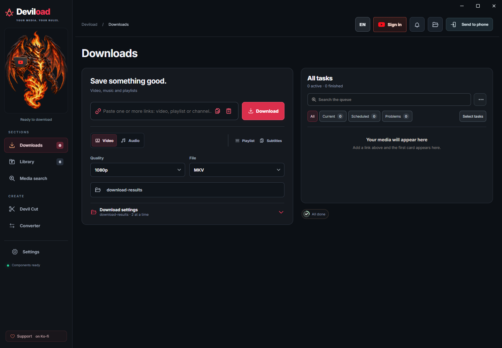
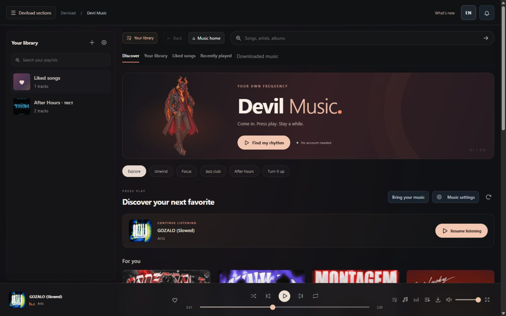
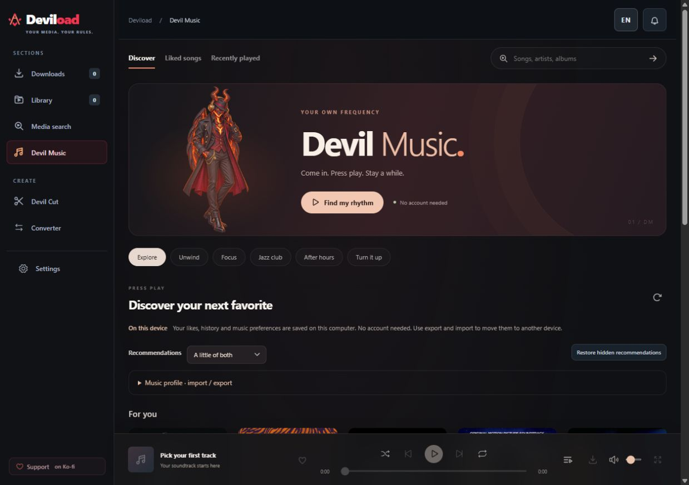
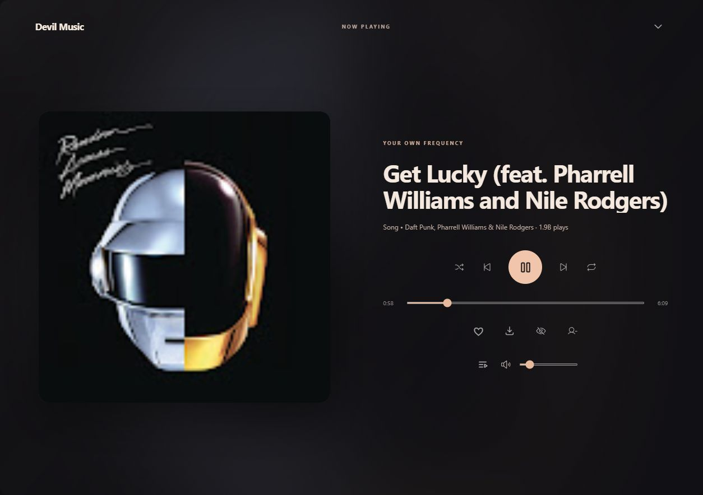
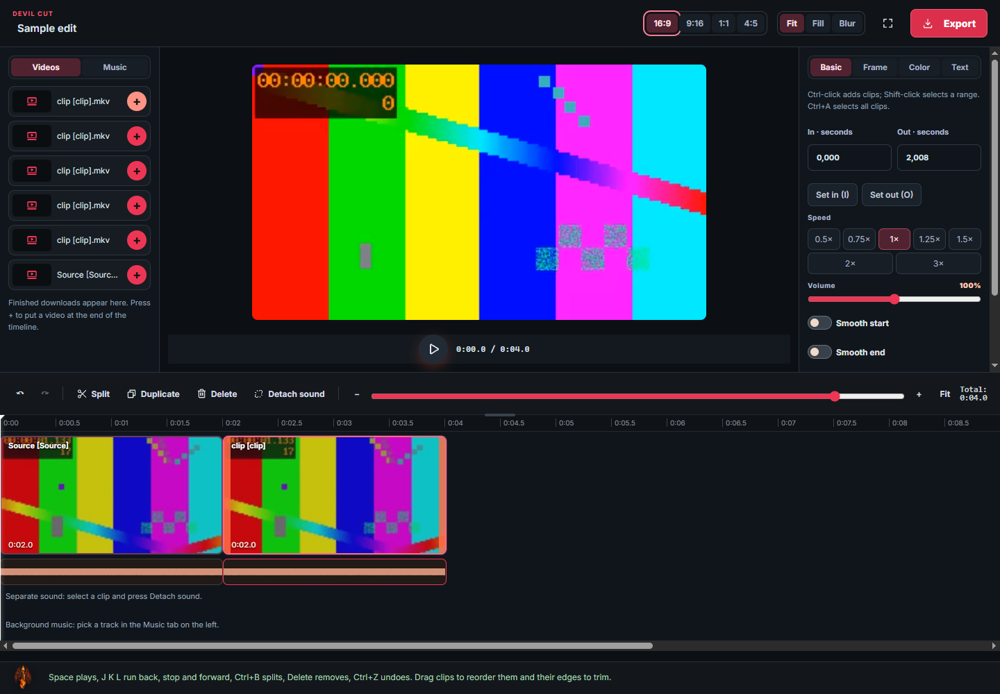
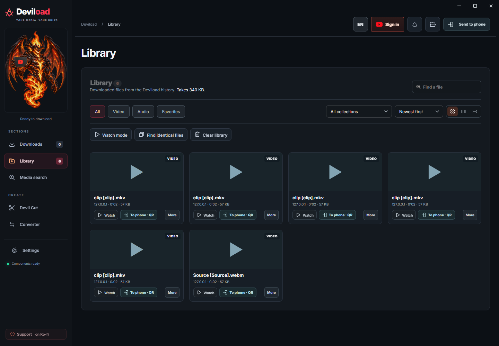
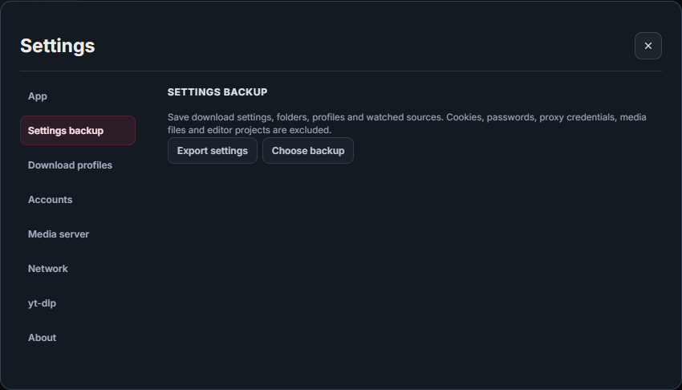
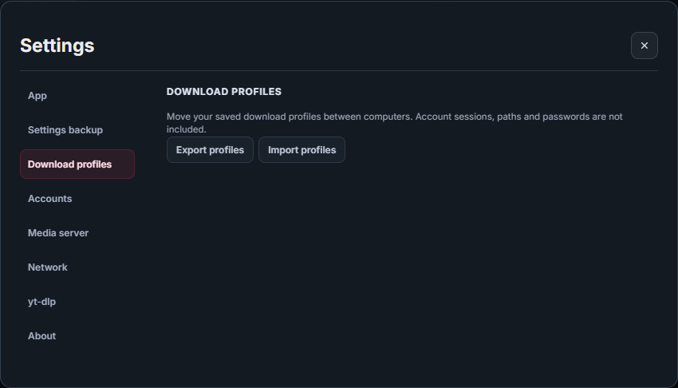

<div align="center">


# Deviload

**Video, music and a little fire.**

Download with yt-dlp. Listen with Devil Music. Edit with Devil Cut.
<br>
Built with Rust and Tauri 2 · English, Russian and Spanish

[](https://github.com/Pronexsteam/deviload/releases/latest)
[](https://github.com/Pronexsteam/deviload/releases/latest)
[](https://github.com/Pronexsteam/deviload/releases/latest)

[](https://github.com/Pronexsteam/deviload/releases/latest)
[](https://github.com/Pronexsteam/deviload/releases)
[](https://github.com/Pronexsteam/deviload)
[](https://github.com/Pronexsteam/deviload/actions/workflows/ci.yml)

[](https://ko-fi.com/pronexsteam)

Deviload is free. If it saves you time, a coffee helps me keep building it.

**[Install & docs](#installation)** · **[Screenshots](#screenshots)** · **[Report an issue](https://github.com/Pronexsteam/deviload/issues/new)** · **[Suggest a feature](https://github.com/Pronexsteam/deviload/issues/new?title=Feature%20request%3A%20)**

</div>



Desktop app for downloading video and music with [yt-dlp](https://github.com/yt-dlp/yt-dlp), built with Rust and [Tauri 2](https://tauri.app). Windows is the main target; macOS and Linux builds come from CI, and the Mac build has been tried on a real Mac. The interface is available in English, Russian and Spanish and switches instantly from the language menu in the top bar.

## Installation

All buttons above open the [latest release](https://github.com/Pronexsteam/deviload/releases/latest). Choose the asset for your system:

| System | Release asset | Instructions |
|---|---|---|
| Windows x64 | `Deviload-<version>-setup.exe` or `Deviload-<version>-windows-x64-portable.zip` | [Windows installation](#install-on-windows) |
| macOS · test build | `Deviload-<version>-macos-test.zip` | [macOS installation](#install-on-macos-test-build) · unsigned and not notarized |
| Linux x86_64 | `Deviload-<version>-amd64.deb` or `Deviload-<version>-x86_64.AppImage` | [Linux installation](#install-on-linux) |

**Documentation:** [Requirements](#requirements) · [Build from source](#build-from-source-windows) · [Releases](#releases) · [Data and privacy](#data-and-privacy) · [Translations](#translations)

## Features

- **Download your way:** video, audio, playlists and live streams, with saved profiles and a persistent queue.
- **Keep a library:** search, favorites, collections, tags and a built-in player.
- **Listen with Devil Music:** browse the YouTube Music catalog without an account, build a queue, get recommendations that adapt to your taste and download songs as MP3.
- **Create with Devil Cut:** trim, arrange clips and export video, audio or GIFs.
- **Stay connected:** watched channels, artist releases, media servers and a local phone link.
- **Make it yours:** three interface languages, proxy settings, settings backups and reduced motion.

<details>
<summary><strong>Explore all features</strong></summary>

- **Download workspace** with the link field, format controls and queue together, animated flame progress, and a mascot that reacts to completed and failed downloads. Motion respects the system's reduced-motion preference.
- **Batch actions** to pause, resume, retry or cancel selected tasks and send completed files to a phone. Clearing completed tasks keeps the library and its file count intact.
- **Saved profiles and settings backup**: reuse download options and destination rules, export profiles, and preview settings imports before restoring them. Backups exclude cookies and account credentials.
- **Downloads** from YouTube, YouTube Music and every other site yt-dlp supports. Best, 1080p, 720p or 480p video as MP4 (plays everywhere, H.264 and AAC when the site has them), MKV (the best streams as they are) or WebM; MP3, FLAC or WAV audio. Profiles for music, archive, phone (MP4) and maximum quality.
- **One link field.** Paste one or more links, or drop a link from the browser anywhere on the window. A preview with the title, duration and the real streams of the source appears by itself; an exact stream can be picked.
- **Playlists**: whole list, first N items or exact ranges, a track picker by title, and splitting by chapters. Subtitles, SponsorBlock removal and a per-format download archive.
- **Live streams** record from the moment you add the link: the task shows the time recorded and the size so far, "Stop recording" keeps what was recorded as a normal MP4, and an optional limit (15 minutes to 24 hours) stops it by itself. With a start time, a length and "Repeat every day" it records the same stream at the same time daily. A recording cut off when Deviload closes is saved at the next start.
- **Watched channels and playlists**: new videos in a followed list download by themselves, in the format picked when the list was added. Lists are checked every 6 hours while Deviload runs, including from the tray.
- **Follow an artist**: give the link of an artist's channel on YouTube or YouTube Music, and every album, EP and single from its Releases tab downloads as MP3 or FLAC into Artist / Album folders, with track numbers, the release year and a square cover. The albums already out can be fetched too; new releases follow by themselves.
- **For Jellyfin, Emby and Plex**: one subfolder choice lays videos out as dated episodes of their channel (Channel / Season year / Channel - date - title) with an `.nfo`, a thumbnail, a `tvshow.nfo` and a poster, and music by artist and album. With the server address and an API key, Deviload asks the server to scan once the downloads finish.
- **Queue** with 1 to 8 parallel downloads, pause, resume, reorder, delayed start, automatic retry of temporary network errors, a per-task log and readable error hints. The queue survives restarts; interrupted tasks resume only when you ask. It can put the computer to sleep or shut it down when the downloads finish, after a minute you can cancel.
- **Self-healing downloads**: known failures are fixed once before a task gives up: your Deviload sign-in when YouTube asks to sign in, the usual quality when an exact stream is gone, a yt-dlp update (when nothing is downloading) when YouTube changes its protection, and a pause after rate limiting.
- **Readable errors** with a fix button: sign in for age-restricted, private or members-only videos, update yt-dlp when YouTube changes its protection.
- **Download archive that follows the disk**: a file deleted from the disk downloads again next time, and when yt-dlp still skips something it downloaded before, the task says how many and "Download again" brings it back.
- **Pre-flight check** before adding: engines present, save folder writable, free disk space, links already downloaded.
- **Library** of finished files with favorites, collections, tags, search, a duplicate finder and a built-in player that remembers the position and shows chapters and subtitles. Sort it by date, size, length or name, group it by channel, and show it as large tiles, small tiles or a list; each file shows its length and size. Removing a file can delete it from the disk too: it goes to the Recycle Bin or Trash, and Undo brings the task back for a few seconds.
- **Devil Cut**, a video editor in its own window, in the spirit of CapCut:
  - media from your downloads on the left, a live preview in the middle, clip settings on the right, and a timeline you can make taller, with the clips' sound, separate sounds and music on their own rows;
  - split at the playhead, select multiple clips to delete or duplicate together, drag to reorder, drag edges to trim, enter precise in/out boundaries, undo and redo, zoom from a two-hour project down to single frames, full screen; long videos stay smooth;
  - detach a clip's sound and move, trim or split it on its own track;
  - transitions between clips (crossfade, through black, slide, wipe, circle) and a sound wave on the tracks;
  - per clip: speed 0.5× to 3×, volume, smooth start and end, rotation, mirror, brightness, contrast, saturation and a caption;
  - frame formats 16:9, 9:16, 1:1 and 4:5 with fit, fill or a blurred background; export to MP4 at the original size, 4K, 1440p, 1080p, 720p or 480p in H.264 or H.265, GIF or MP3 with progress, into the folder the video came from or one you choose;
  - projects are saved automatically, and source files are never changed.
- **Audio tools** for MP3, FLAC and WAV: tags and loudness normalization, saved as a new copy.
- **Devil Convert** in its own window: drop any video or audio file from the computer, or send one from the library, and get MP4, MP3, a GIF, or a video that fits a size limit (Discord 10 MB, WhatsApp 16 MB, mail 25 MB or your own) through two-pass encoding. The original stays as it is; results go next to it or into the export folder shared with Devil Cut.
- **Phone link** over the local network: one QR code opens a page on the phone that downloads the files you send from Deviload, sends photos and videos back to the computer (each one needs your OK), and adds links to the download queue. The link turns off after 30 minutes without the phone, and the page can be added to the phone's home screen.
- **Search** YouTube and YouTube Music inside the app.
- **Devil Music**: guest playback, albums and playlists, a full-screen Now Playing view, shuffle, repeat, queue editing and similar songs when the queue ends. The next song is prepared in advance to reduce waiting. Availability depends on YouTube and your network; restricted or unavailable tracks can still fail.
- **Download from Devil Music** with the MP3 button on a song card, queued song or the player. It adds a task to the download queue without stopping playback, using your save folder and download authentication settings. Your unfinished download form stays intact.
- **Bring your music**: import public Spotify playlists and albums, YouTube playlists, and snapshots of up to 100 songs from YouTube Mix links. Spotify previews can omit tracks; a Mix may differ from your signed-in recommendations and will not update automatically. Matching can be stopped or canceled; uncertain matches remain reviewable.
- **Your music taste stays local**: likes, listening and early skips shape recommendations. Hide songs or artists, choose familiar music or more discoveries, and export/import a compact profile before reinstalling or changing computers. No Devil Music account or paid server is needed.
- **Music controls** in the Windows taskbar thumbnail and the tray menu, plus supported system media controls.
- **Site sessions** for YouTube, Instagram, TikTok and X: supported embedded sign-in windows save a session for that site only. YouTube on Linux uses cookies from your regular browser or a `cookies.txt` file instead of embedded Google sign-in. Firefox cookies or your own `cookies.txt` also work on Windows and macOS (and Chrome, Edge, Brave or Safari on macOS).
- **Updates**: Deviload checks GitHub at start and every 6 hours and updates itself in one click on Windows, macOS and in the AppImage, all from one release (the portable zip and the .deb package point to the releases page); yt-dlp updates itself to the nightly build once a day when nothing is downloading, which can be turned off in the settings.
- **Proxy** for downloads, search, link checks and yt-dlp updates (HTTP, HTTPS, SOCKS4 and SOCKS5).
- **Moving from Deviload 1.x**: the history, settings and the list of downloaded videos of the old portable version move over in one click; cookies are not copied.
- Tray mode and start with Windows, OS notifications, clipboard link suggestions, links from a text file, a copyable yt-dlp command in every task log, keyboard shortcuts (Ctrl/⌘+L links, Ctrl/⌘+K queue search, Ctrl/⌘+Enter download, Escape closes dialogs) and a short guided tour. Only one copy of Deviload runs at a time; starting it again brings the open window forward.

</details>

## Screenshots



| Devil Music · discover | Devil Music · Now Playing |
|---|---|
|  |  |

| Devil Cut | Library |
|---|---|
|  |  |
| **Settings backup** | **Download profiles** |
|  |  |

The full-width music workspace shows 2.7 with the live catalog and a sample local playlist. The older music views show 2.6.7; the other workspace screenshots show 2.6.5 with sample media.

## Install on Windows

Download `Deviload-<version>-setup.exe` from the releases page and run it. It installs for the current user without administrator rights, adds a Start menu shortcut (in the Pronexsteam folder) and brings yt-dlp, FFmpeg and Deno along. Any folder you can write to works; folders inside Program Files need administrator rights, so the installer stops and says so. Later versions install from inside the app. A portable zip is published next to it.

## Install on macOS (test build)

Download `Deviload-<version>-macos-test.zip` from the [latest release](https://github.com/Pronexsteam/deviload/releases/latest), extract it and move `Deviload.app` to Applications. The build is not signed with an Apple Developer ID or notarized. Before the first start, run:

```sh
xattr -cr /Applications/Deviload.app
```

The archive includes yt-dlp, FFmpeg and Deno. The in-app updater signature is separate from Apple code signing.

## Install on Linux

`sudo apt install ./Deviload-<version>-amd64.deb` on Debian or Ubuntu, or make the AppImage executable (`chmod +x Deviload-<version>-x86_64.AppImage`) and run it. Both bring yt-dlp, FFmpeg and Deno along; the AppImage updates itself from inside the app, the .deb package is updated by installing the new one. The built-in player uses the system's GStreamer, so MKV playback needs its usual plugins (`gstreamer1.0-plugins-good`).

## Requirements

Deviload runs yt-dlp, FFmpeg, FFprobe and Deno as separate processes. It looks for them next to the executable, in a `bin` folder next to it, and in `PATH` (plus `/opt/homebrew/bin` and `/usr/local/bin` on macOS). Windows also needs the Microsoft Edge WebView2 Runtime, which Windows 10 and 11 normally include.

## Build from source (Windows)

You need Node.js 22 or newer, Rust with the MSVC toolchain and Visual Studio Build Tools with the C++ workload and a Windows SDK.

```powershell
npm ci
powershell -ExecutionPolicy Bypass -File scripts\fetch-tools.ps1   # yt-dlp, FFmpeg, FFprobe, Deno into .\bin
npm run tauri dev                                                  # run in development mode
powershell -ExecutionPolicy Bypass -File scripts\package.ps1      # installer, portable zip and latest.json in .\dist
```

`scripts\package.ps1` builds the release, copies the installer to `dist\Deviload-<version>-setup.exe`, writes the update feed `dist\latest.json` and assembles a portable `dist\Deviload\` folder (`Deviload.exe`, the engines in `bin\`, the licence texts) zipped as `dist\Deviload-<version>-windows-x64-portable.zip`.

In-app updates are signed. The script reads the private key and its password from `TAURI_SIGNING_PRIVATE_KEY` and `TAURI_SIGNING_PRIVATE_KEY_PASSWORD`, or from a key file with a `.password` file next to it: `DEVILOAD_UPDATER_KEY`, then `keys\deviload-updater.key` (the `keys` folder is ignored by git), then `%USERPROFILE%\.tauri\deviload-updater.key`. The matching public key is in `src-tauri/tauri.conf.json`; a build signed with any other key cannot update existing installs.

## Releases

Pull requests run the four required platform checks before merging into protected `main`. The same CI matrix does not run again on the merge. Pushing a tag that matches the app version, for example `v2.7.1`, starts `.github/workflows/release.yml` for release packaging, its validation steps, and updater signing. Windows creates a draft with the installer and portable ZIP; macOS and Linux then add their packages. Only after every platform succeeds does the workflow publish the release and its combined `latest.json`. If any platform fails, the release stays a draft and the previous update feed remains available. Updater artifacts are signed for existing installations; the macOS app itself is not notarized. The release description comes from `.github/release-notes/<tag>.md` when that file exists; changing the file on `main` later updates the published description too. The repository needs two secrets: `TAURI_SIGNING_PRIVATE_KEY` (the content of the key file) and `TAURI_SIGNING_PRIVATE_KEY_PASSWORD`. Installed copies read the update feed from the `updates` branch ([update feed](https://raw.githubusercontent.com/Pronexsteam/deviload/updates/latest.json)), so update checks do not count as downloads; the copy attached to each release stays as a fallback for 2.0.0. The same run adds an unsigned macOS test build, `Deviload-<version>-macos-test.zip`, with yt-dlp, FFmpeg and Deno inside (`scripts/fetch-tools-macos.sh`). It is not notarized, so it needs `xattr -cr /Applications/Deviload.app` once before the first start. `.github/workflows/macos.yml` rebuilds only that file for the release of the current version when the `macos-test` branch is pushed.

## Build from source (Linux)

On Debian or Ubuntu install the libraries Tauri builds against, then:

```sh
sudo apt install libwebkit2gtk-4.1-dev libappindicator3-dev librsvg2-dev patchelf libxdo-dev libssl-dev
bash scripts/fetch-tools-linux.sh   # yt-dlp, FFmpeg, FFprobe, Deno into ./bin
npm ci
npm run tauri dev
npm run tauri build -- --config src-tauri/tauri.ci.conf.json   # .deb and AppImage, without update signing
```

## Build from source (macOS)

Install the Xcode Command Line Tools, Rust and Node.js, then add both Rust targets for a universal build:

```sh
bash scripts/fetch-tools-macos.sh   # yt-dlp, FFmpeg, FFprobe, Deno into ./bin
rustup target add aarch64-apple-darwin x86_64-apple-darwin
npm ci
npm run tauri dev
npm run tauri build -- --target universal-apple-darwin --bundles app --config src-tauri/tauri.macos-bundle.conf.json
```

Without the script, engines from `brew install yt-dlp ffmpeg deno` work too.

Published macOS builds are not signed with an Apple Developer ID or notarized. The in-app updater signature is separate from Apple code signing.

## Data and privacy

The queue (`queue.json`), per-format download archives and the saved YouTube sign-in (`youtube-cookies.txt`) live in the app data folder: `%APPDATA%\com.deviload.desktop` on Windows, `~/Library/Application Support/com.deviload.desktop` on macOS. The sign-in export keeps only YouTube and Google cookies and never leaves your computer. Library tags, collections, player positions, Devil Cut projects and the proxy are stored in `library.json`, watched lists and artists in `watches.json` and the phone link key in `phone.json`, all in the same folder. The media server address and API key, if you set them, are kept in `queue.json` and are only sent to that server. Files received from a phone go to `Deviload from phone` inside the download folder.

Deviload has no telemetry. Besides the sites you download from, it contacts GitHub to check for a new Deviload (only the version number is requested) and to update yt-dlp; the yt-dlp update can be turned off in the settings. The phone link only listens on the local network address and only while it is on; every file a phone sends needs your confirmation.

Devil Music contacts YouTube Music for catalog results, artwork hosts for covers, and YouTube media servers for audio. Opening lyrics sends the track title, artist and duration to LRCLIB. Its listening profile stays in local WebView storage. Likes are never automatically evicted; recent history is bounded to 80 songs and recommendation history to 1,000 learned tracks. Profiles also keep up to 30 playlists with 500 total entries and 200 saved artists, albums or catalog playlists. Export/import files are limited to 2 MB and contain metadata and preferences, not music files or account credentials. If a profile reaches the storage limit, saving reports an error rather than removing older likes. Reinstalling the operating system can erase local preferences; export a backup first.

The current development version adds filtered, paginated music search, saved artists and albums, playback from existing full-track downloads, timed lyrics, equalizer presets, volume smoothing and optional track overlap. Smoothing is a compressor, not measured album loudness normalization. Regional charts can be hidden; personal discovery uses local listening signals, likes, followed artists and explicit exclusions. This is adaptive ranking, not a trained neural recommendation model.

Playback prepares the next track and likely selections in advance, with bounded background requests and a second audio decoder. Cached signed links are retained until their expiry safety margin, for at most one hour. Unprepared tracks still depend on upstream extraction and media availability; instant startup is not guaranteed. Rate limits stop requests instead of triggering an endless retry loop.

Engines run with an argument list and no shell. A task counts as finished only when yt-dlp exits with code 0, and the queue file is written atomically.

## Tests

```sh
npm run check
npm test
cargo test --manifest-path src-tauri/Cargo.toml --locked
cargo test --manifest-path src-tauri/Cargo.toml --locked -- --include-ignored   # also runs FFmpeg/yt-dlp integration tests
```

The integration tests generate their own media and serve it from a local HTTP server, so they need the engines but no network. `npm test` also checks that every interface string has a Russian translation. The integration tests also render Devil Cut projects with transitions, music, captions, GIF and MP3 output through FFmpeg.

## Translations

English is the source language. Russian strings live in `src/locales/ru.js`, keyed by the English text. Messages from the Rust core are English and are translated in the interface, including messages that carry runtime values (`"Search failed: {detail}"`).

## Team

Deviload is maintained by Samvel Avetisyan ([Pronexsteam](https://github.com/Pronexsteam)). Outside contributions arrive as pull requests and are reviewed by the maintainer.

Deviload transfers no information to other networked systems except the sites you download from, GitHub for update checks, which ask only for the version number and, while you use the phone link, the phone on your local network. See [Data and privacy](#data-and-privacy).

## Support

Deviload is free and stays free. If it saves you time, you can buy me a coffee on [Ko-fi](https://ko-fi.com/pronexsteam); it helps me keep working on it.

## Licence

Deviload is [MIT licensed](LICENSE). The Windows installer and the portable build ship yt-dlp (Unlicense), FFmpeg (GPL v3 build) and Deno (MIT); see [bundled licences](LICENSES/README.txt) for details and the other bundled components.
